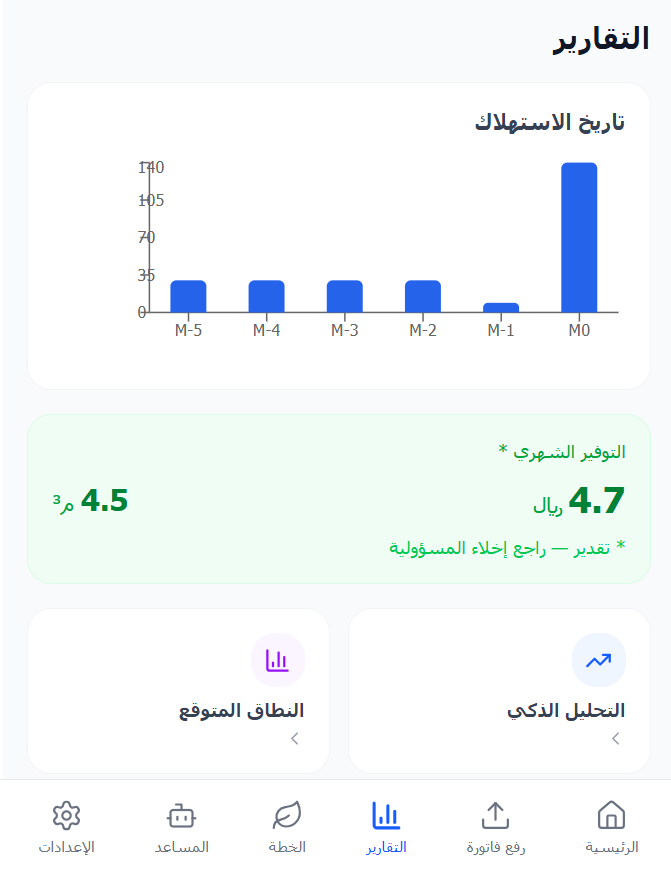
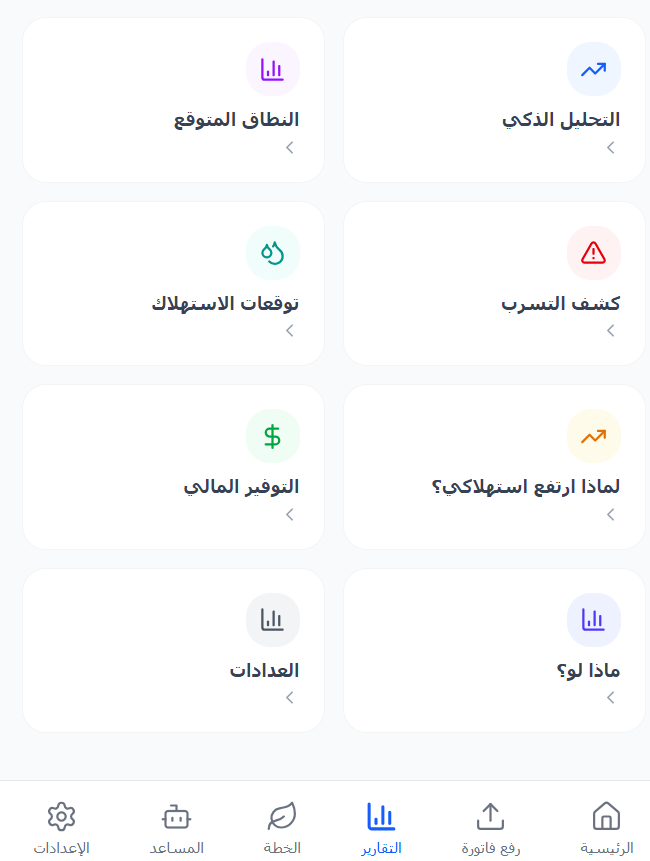
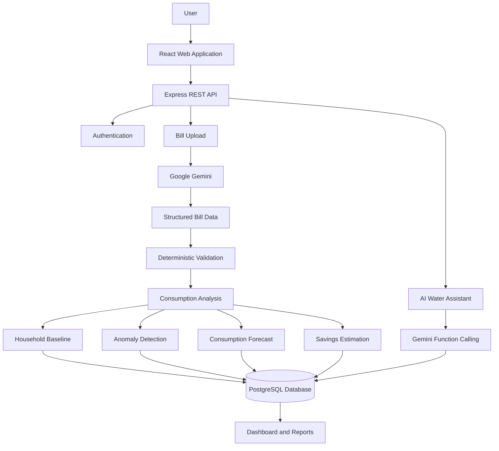

# Rashed | AI-Assisted Water Conservation

**Rashed (رشد)** is a bilingual AI-assisted water conservation platform designed to help Saudi households understand their water consumption, analyze water bills, identify unusual consumption patterns, and explore practical water-saving strategies.

The platform combines deterministic backend calculations with Google Gemini AI to extract information from water bills, interpret consumption patterns, and generate personalized conservation recommendations.

**My Role:** Team Lead | AI Component & Research | Team of 5

**Live Demo:** [Rashed Web Application](https://rashed-water.replit.app)

**GitHub Repository:** [hanan-alharbi-cs/Rashed](https://github.com/hanan-alharbi-cs/Rashed)

---

## Project Overview

Household water consumption can be difficult to monitor without clear insights into billing information, historical usage, and expected consumption levels.

Rashed addresses this challenge through an integrated platform that brings together water-bill extraction, household consumption analysis, anomaly detection, forecasting, savings estimation, and AI-assisted recommendations.

The application is designed to help households understand their water usage and make more informed decisions about water conservation.

## Problem Statement

Households may struggle to:

- Understand the information displayed on water bills.
- Track and compare monthly water consumption.
- Identify unusual increases in water usage.
- Recognize consumption patterns that may indicate potential leaks.
- Estimate the impact of water-saving actions.
- Translate consumption data into practical conservation decisions.

## Proposed Solution

Rashed provides a bilingual web application that processes water-bill information and combines it with household characteristics and historical consumption records.

The platform uses Google Gemini for image-based bill extraction and AI-generated interpretations, while deterministic backend calculations handle numerical analysis, consumption baselines, anomaly indicators, forecasts, and savings estimates.

This separation helps maintain consistency in numerical calculations while using AI to make the results easier to understand.

---

## Key Features

### 1. AI-Powered Water Bill Extraction

- Upload water-bill images or meter images.
- Extract structured information using Google Gemini multimodal capabilities.
- Identify available consumption and billing information.
- Return structured JSON data for backend processing.
- Validate extracted values before using them in analysis.

### 2. Household Consumption Baseline

- Estimate expected household consumption.
- Consider household size and property type.
- Account for garden and swimming-pool characteristics.
- Incorporate historical consumption when available.
- Compare actual consumption against an estimated household range.

### 3. Water Consumption Analysis

- Analyze current and previous consumption.
- Calculate percentage changes between bills.
- Compare household consumption against its estimated baseline.
- Classify consumption as above, below, or within the expected range.

### 4. Potential Leak and Anomaly Detection

- Identify consumption above the household baseline.
- Detect increases exceeding 20% compared with the previous bill.
- Generate potential leak alerts.
- Display risk indicators to help households investigate unusual usage.

These alerts indicate unusual consumption patterns and do not confirm that a physical water leak exists.

### 5. Consumption Forecasting

- Estimate month-end water consumption.
- Use a linear daily-rate calculation.
- Present projected consumption through visual charts.

### 6. AI-Powered Recommendations

- Generate personalized water conservation recommendations.
- Suggest possible explanations for increased consumption.
- Provide practical household water-saving guidance.
- Organize recommendations by category and priority.

### 7. Water Conservation Plans

- Generate practical conservation actions.
- Support household-specific recommendations.
- Organize suggested actions into manageable steps.
- Support tracking of recommendation completion.

### 8. Savings Estimation

- Estimate potential water savings.
- Calculate estimated financial savings.
- Compare current consumption with a target reduction level.
- Apply configured water tariff tiers.

### 9. What-If Simulation

- Explore alternative consumption scenarios.
- Simulate target monthly consumption levels.
- Compare current and target consumption.
- Estimate potential water and financial savings.

### 10. AI Water Assistant

- Provide an interactive bilingual assistant.
- Answer questions using available household consumption information.
- Retrieve recent and historical consumption records.
- Explain current analysis results and alerts.
- Provide conservation recommendations.
- Support savings calculations and What-If simulations.
- Use Gemini Function Calling to access specific backend tools.

The assistant is connected to 11 function-calling tools for retrieving household information, consumption history, bills, analyses, alerts, forecasts, recommendations, official references, savings calculations, and What-If simulations.

### 11. Interactive Dashboard and Reports

- Display household consumption summaries.
- Visualize consumption trends.
- Present analysis results and alerts.
- Show forecasts and savings estimates.
- Provide access to different consumption-analysis modules.

### 12. Bilingual Interface

- Arabic and English language support.
- Right-to-left (RTL) layout for Arabic.
- Left-to-right (LTR) layout for English.
- Language preference stored locally.

---

## Application Screenshots

The following screenshots showcase the main interfaces and features of Rashed.

### 1. Home Page


### 2. Bill Upload


### 3. Consumption Reports



### 4. Additional Analysis Tools



### 5. Conservation Plan


### 6. AI Assistant


---

## How It Works

Rashed follows a workflow that combines image extraction, backend validation, deterministic consumption analysis, and AI-assisted interpretation.

1. **Bill Upload:** The user uploads a water-bill image or selects the demo mode.
2. **AI Extraction:** The backend sends the image to Google Gemini to extract structured billing information.
3. **Structured Data Validation:** The extracted fields are validated using deterministic backend rules.
4. **Household Data Retrieval:** The system retrieves household characteristics and historical consumption records.
5. **Consumption Analysis:** Backend calculations determine household baselines, consumption changes, and anomaly indicators.
6. **AI Interpretation:** Gemini interprets the available analysis results and generates possible explanations and recommendations.
7. **Data Storage:** The system stores the bill information, analysis results, and related records in PostgreSQL.
8. **Dashboard Presentation:** The application presents the results through its dashboard, charts, reports, alerts, and recommendations.

---

## System Architecture

Rashed follows a client-server architecture consisting of a React web application, an Express REST API, a PostgreSQL database, and Google Gemini AI integration.



### Frontend – React Web Application

The frontend provides the bilingual user interface and household water-management experience.

Its responsibilities include:

- User authentication interfaces.
- Water-bill and meter-image uploads.
- Household profile and meter management.
- Consumption analysis and visualizations.
- Baseline and forecast presentation.
- Leak detection and alert interfaces.
- Conservation plans and savings estimation.
- What-If simulation.
- AI assistant interaction.
- Reports and settings.

### Backend – Express REST API

The backend handles application requests and business logic through Express.

Its responsibilities include:

- Authentication and session management.
- User and household management.
- Water-bill image uploads.
- Gemini integration and structured extraction.
- Extracted data validation.
- Consumption analysis.
- Household baseline calculations.
- Anomaly and potential leak detection.
- Forecasting and savings calculations.
- Conservation recommendations and plans.
- AI assistant and function-calling operations.

### Database Layer

Rashed uses PostgreSQL as its relational database.

Drizzle ORM manages database queries and schema definitions.

The database stores:

- User and household information.
- Household members and property characteristics.
- Water bills and consumption records.
- Meters and meter readings.
- Consumption analyses.
- Alerts and anomaly records.
- Forecasts and recommendations.
- Savings estimates and tariff configurations.
- AI assistant conversations and messages.

### AI Integration

Google Gemini is integrated through the Google Gen AI SDK.

Gemini is used for:

- Multimodal water-bill information extraction.
- Producing structured JSON responses.
- Interpreting consumption-analysis results.
- Suggesting possible reasons for increased consumption.
- Generating personalized recommendations.
- Supporting the AI assistant through Function Calling.

The backend remains responsible for numerical calculations and validation.

---

## Technology Stack

### Frontend Development

| Component | Technologies |
|---|---|
| Programming Language | TypeScript 5.9 |
| UI Library | React 19 |
| Build Tool | Vite |
| Styling | Tailwind CSS 4 |
| UI Components | Radix UI |
| Data Fetching & State | TanStack Query |
| Charts & Visualization | Recharts |
| Routing | Wouter |
| Icons | Lucide React |
| Localization | Custom Arabic/English i18n |
| UI Utilities | Class Variance Authority, clsx, Tailwind Merge |

### Backend Development

| Component | Technologies |
|---|---|
| Runtime | Node.js 24 |
| Programming Language | TypeScript |
| Backend Framework | Express 5 |
| API Architecture | REST APIs |
| File Upload | Multer |
| Authentication | JWT, bcrypt |
| Session Management | Express Session |
| Session Storage | PostgreSQL Session Store |
| Logging | Pino, Pino HTTP |
| Middleware | CORS, Cookie Parser |

### Artificial Intelligence & Gemini Integration

| Component | Technologies |
|---|---|
| AI Platform | Google Gemini |
| AI Model | Gemini 2.5 Flash |
| SDK | Google Gen AI SDK |
| Image Processing | Gemini Multimodal Input |
| Structured Output | JSON Responses |
| AI Assistant | Gemini Function Calling |
| AI Integration | Replit AI Integrations |

### Database & API Development

| Component | Technologies |
|---|---|
| Database | PostgreSQL |
| ORM | Drizzle ORM |
| Database Client | node-postgres (pg) |
| API Specification | OpenAPI |
| API Client Generation | Orval |
| Schema Validation | Zod |
| API Types | Generated TypeScript Types |
| Workspace Management | pnpm Workspaces |

---

## AI and Backend Design

One of the key design principles in Rashed is separating AI interpretation from deterministic calculations.

### Google Gemini Responsibilities

Gemini is responsible for AI-assisted tasks, including:

- Extracting visible information from water bills and meter images.
- Producing structured JSON responses.
- Interpreting consumption-analysis results.
- Suggesting possible reasons for increased consumption.
- Generating personalized water conservation recommendations.
- Supporting interactive conversations through Function Calling.

### Deterministic Backend Responsibilities

The backend is responsible for numerical calculations and validation, including:

- Validating extracted billing information.
- Calculating consumption changes.
- Estimating household consumption baselines.
- Detecting unusual consumption patterns.
- Calculating estimated costs and savings.
- Generating consumption forecasts.
- Applying configured tariff tiers.

This separation helps keep numerical and financial calculations consistent and independently verifiable.

---

## Important Implementation Details

### 1. Household Consumption Baseline

Rashed uses a GASTAT 2023 statistical reference of:

**102.1 liters per person per day.**

The household baseline calculation considers:

- Household member count.
- Property type.
- Garden availability.
- Swimming-pool availability.
- Historical consumption records.

When historical consumption is available, the system combines the household profile estimate with historical averages.

The resulting baseline is an estimated household consumption range, not a strict consumption limit.

### 2. Potential Leak Detection

The system identifies unusual consumption when:

- Current consumption exceeds the household baseline maximum.
- Consumption increases by more than 20% compared with the previous bill.

These conditions generate potential leak and anomaly indicators.

The alerts are intended to help users investigate unusual water consumption and do not independently confirm a physical leak.

### 3. Consumption Forecasting

The current implementation uses a simple linear daily-rate calculation to estimate month-end consumption.

The forecast is based on observed consumption and elapsed billing-period information.

It is not currently generated by a trained forecasting machine-learning model.

### 4. Savings Estimation

The backend calculates estimated water and financial savings by comparing current consumption with a selected target consumption level.

The calculation uses configured tariff tiers.

Monetary results are estimates because the configured tariff is treated as unverified.

### 5. Gemini Function Calling

The AI assistant uses 11 backend tools to retrieve information and perform supported calculations.

The available tools include:

- Household profile retrieval.
- Recent consumption retrieval.
- Consumption history retrieval.
- Latest bill retrieval.
- Latest analysis retrieval.
- Active alerts retrieval.
- Consumption forecast retrieval.
- Recommendations retrieval.
- Verified water-reference retrieval.
- Savings calculation.
- What-If simulation.

The tools connect Gemini conversations with relevant household data and backend calculations.

---

## My Role & Contribution

**Role: Team Lead | AI Component & Research**

I served as the Team Lead of Rashed, helping guide the team's work and coordinate efforts toward achieving the project objectives.

In addition to my leadership responsibilities, I was responsible for the AI-focused part of the project, including research and gathering relevant information to support its development.

My contributions included:

- **Team Leadership:** Leading a team of five, coordinating tasks, and helping align our work with the project's objectives.
- **AI Component:** Taking responsibility for the AI-related component and researching how Google Gemini could support water-bill data extraction, consumption analysis, and personalized conservation recommendations.
- **Research & Information Gathering:** Researching household water consumption, water conservation, and relevant supporting information and references.
- **AI Use Cases:** Identifying opportunities to apply AI to make water-consumption data easier to understand and support informed household decisions.
- **Project Coordination:** Helping coordinate the team's work and maintain alignment between the proposed solution and its implementation.

Through this experience, I developed my skills in team leadership, AI-focused research, problem-solving, technical collaboration, and applying AI technologies to a real-world sustainability challenge.

---

## Data Sources

The project uses the following references to support its water-consumption analysis and recommendations.

- [GASTAT – Water Accounts Publication 2023](https://www.stats.gov.sa/documents/20117/2067030/Water%2BAccounts%2BPublication%2B2023%2BEN.pdf)
- [National Water Company – Rasshid Initiative](https://www.nwc.com.sa/EN/HousingSector/Pages/RashedInitiative.aspx)

The GASTAT reference is used as a statistical benchmark for household consumption.

The NWC Rasshid Initiative is included as a supporting reference for understanding the importance of household leak detection.

---

## Repository Structure

```text
Rashed/
│
├── artifacts/
│   │
│   ├── rashed/
│   │   └── src/
│   │       ├── pages/
│   │       ├── components/
│   │       ├── hooks/
│   │       ├── lib/
│   │       └── locales/
│   │
│   ├── api-server/
│   │   └── src/
│   │       ├── routes/
│   │       ├── lib/
│   │       └── middlewares/
│   │
│   └── mockup-sandbox/
│
├── lib/
│   │
│   ├── db/
│   │   └── src/
│   │       └── schema/
│   │
│   ├── api-spec/
│   │
│   ├── api-client-react/
│   │
│   ├── api-zod/
│   │
│   ├── integrations-gemini-ai/
│   │
│   └── integrations/
│
├── scripts/
│
├── package.json
├── pnpm-workspace.yaml
├── tsconfig.json
└── README.md
```

---

## Setup & Development

Rashed is organized as a pnpm workspace containing the frontend, API server, and shared libraries.

### Prerequisites

- Node.js 24
- pnpm
- PostgreSQL
- Google Gemini API integration credentials

### Install Dependencies

Clone the repository:

```bash
git clone https://github.com/hanan-alharbi-cs/Rashed.git

cd Rashed
```

Install workspace dependencies:

```bash
pnpm install
```

### Environment Configuration

Configure the required environment variables for the API server and integrations.

The Gemini integration uses:

```env
AI_INTEGRATIONS_GEMINI_API_KEY=
AI_INTEGRATIONS_GEMINI_BASE_URL=
```

The database connection must also be configured for PostgreSQL.

Do not commit private credentials or API keys to the repository.

### Development

The repository uses pnpm workspaces to manage the frontend, API server, and shared libraries.

Refer to the package scripts and workspace configuration for the available development, build, and type-check commands.

---

## Important Notes & Limitations

- Gemini-generated explanations and recommendations are possible interpretations, not confirmed facts.
- Potential leak alerts are based on consumption patterns and predefined thresholds.
- Forecasting currently uses a simple linear method rather than a trained forecasting model.
- Financial calculations are estimates based on the configured tariff.
- The configured tariff is treated as unverified and should not be interpreted as an official confirmed billing amount.
- Demo data is synthetic and should not be confused with actual household consumption.
- The GASTAT consumption reference is a statistical benchmark and not a strict household consumption limit.
- A potential leak alert does not confirm the existence of a physical leak.

---

## Future Improvements

- Expand the availability of verified household consumption data.
- Improve consumption forecasting methods.
- Enhance anomaly detection and household-specific analysis.
- Expand AI assistant capabilities.
- Improve explainability of AI-generated recommendations.
- Strengthen application security and data validation.
- Expand reporting and household water-management features.

---

**Rashed — Turning Water Consumption Data into Actionable Insights.**
