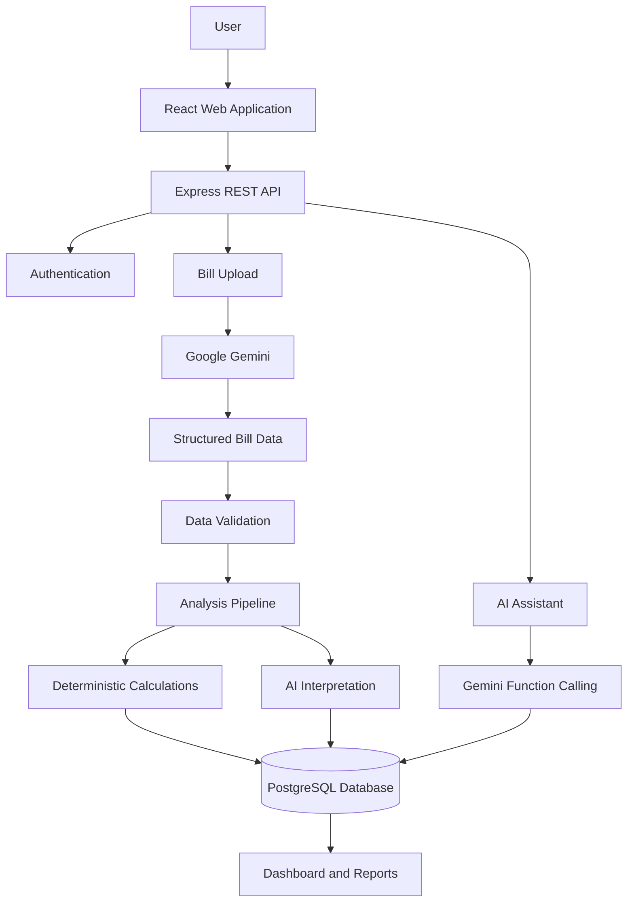

# Rashed | AI-Assisted Water Conservation

**Rashed (رشد)** is a bilingual web application designed to help Saudi households understand their water consumption, analyze water bills, identify unusual consumption patterns, and explore practical water conservation strategies.

The platform combines deterministic backend calculations with Google Gemini AI to extract information from water bills, interpret consumption patterns, and generate personalized recommendations.

**Live Demo:** [Rashed Web Application](https://rashed-water.replit.app)

**GitHub Repository:** [hanan-alharbi-cs/Rashed](https://github.com/hanan-alharbi-cs/Rashed)

---

## The Problem

Households may struggle to understand their water consumption, compare bills over time, and recognize patterns that could indicate excessive usage or potential water leaks.

Rashed addresses this challenge by bringing bill extraction, household information, historical consumption, and AI-assisted insights together in one platform.

## Key Features

- **AI-Powered Bill Extraction:** Upload water bills or meter images and extract structured consumption information using Google Gemini.
- **Household Consumption Baseline:** Estimate expected water consumption based on household size, property type, garden, pool, and historical usage.
- **Consumption Analysis:** Compare current and previous consumption and identify unusual changes.
- **Potential Leak Alerts:** Flag abnormal consumption patterns and display potential leak risk indicators.
- **Consumption Forecasting:** Estimate end-of-month water consumption using a linear daily-rate calculation.
- **AI-Powered Recommendations:** Generate personalized water conservation suggestions and possible explanations for increased consumption.
- **Water Conservation Plans:** Generate practical actions based on household information and a selected reduction goal.
- **Savings Estimation:** Estimate potential water and financial savings using configured tariff tiers.
- **What-If Simulation:** Explore different consumption-reduction scenarios and compare estimated results.
- **Interactive Dashboard and Reports:** Visualize consumption trends, analysis results, alerts, and savings.
- **Bilingual Interface:** Support Arabic and English with RTL and LTR layouts.

## How It Works

1. The user uploads a water bill or selects the demo mode.
2. The backend receives the uploaded document and sends it to Gemini for structured data extraction.
3. The extracted information is validated using deterministic backend rules.
4. The system retrieves household details and historical consumption records.
5. Backend calculations determine the household baseline, consumption changes, and anomaly indicators.
6. Gemini interprets the supplied results and generates possible explanations and recommendations.
7. The system stores the analysis and presents the results through the application dashboard.

## System Architecture



## Technology Stack

| Component | Technologies |
|---|---|
| Frontend | React 19, TypeScript 5.9, Vite |
| Styling | Tailwind CSS 4, Radix UI |
| Data Fetching | TanStack Query |
| Charts | Recharts |
| Backend | Node.js 24, Express 5 |
| Database | PostgreSQL |
| ORM | Drizzle ORM |
| AI Integration | Google Gen AI SDK, Gemini 2.5 Flash |
| File Upload | Multer |
| Authentication | Express Session, PostgreSQL Session Store |
| API Contracts | OpenAPI, Orval, Zod |
| Workspace Management | pnpm Workspaces |

## AI and Backend Design

One of the key design principles in Rashed is separating AI interpretation from deterministic calculations.

**Google Gemini is responsible for:**
- Extracting visible information from water bill images.
- Producing structured JSON responses.
- Interpreting consumption analysis results.
- Suggesting possible reasons for increased consumption.
- Generating personalized water conservation recommendations.
- Supporting an interactive assistant through Function Calling.

**The backend is responsible for:**
- Validating extracted bill information.
- Calculating consumption changes.
- Estimating household consumption baselines.
- Detecting unusual consumption patterns using predefined rules.
- Calculating estimated costs and savings.
- Generating consumption forecasts.

This separation helps keep numerical and financial calculations consistent and independently verifiable.

## Repository Structure

```text
.
├── artifacts/
│   ├── rashed/
│   │   └── src/
│   │       ├── pages/
│   │       ├── components/
│   │       ├── hooks/
│   │       ├── lib/
│   │       └── locales/
│   │
│   ├── api-server/
│   │   └── src/
│   │       ├── routes/
│   │       ├── lib/
│   │       └── middlewares/
│   │
│   └── mockup-sandbox/
│
├── lib/
│   ├── db/
│   ├── api-spec/
│   ├── api-client-react/
│   └── api-zod/
│
├── scripts/
├── package.json
└── pnpm-workspace.yaml
```

## Important Implementation Details

### Household Consumption Baseline

The system uses a GASTAT 2023 statistical reference of 102.1 liters per person per day.

The baseline calculation also considers household characteristics and historical consumption records to estimate an expected monthly consumption range.

This value is used as a statistical reference rather than a strict consumption limit for every household.

### Potential Leak Detection

The system identifies unusual consumption when:
- Current consumption exceeds the household baseline maximum.
- Consumption increases by more than 20% compared with the previous bill.

These indicators generate potential leak alerts. They do not confirm that a physical leak exists.

### Consumption Forecasting

The current implementation uses a simple linear daily-rate calculation to estimate month-end consumption.

### Savings Estimation

The backend calculates estimated water and financial savings by comparing current consumption with a target consumption level using configured tariff tiers.

Monetary results are estimates because the configured tariff is treated as unverified.

## Project Contribution

Rashed is a collaborative project.

My contribution focused on the AI-related component, researching relevant information, and exploring how AI can support water bill extraction, consumption interpretation, and personalized conservation recommendations.

The project combines these AI capabilities with backend calculations and a full-stack web application.

## Data Sources

- [GASTAT – Water Accounts Publication 2023](https://www.stats.gov.sa/documents/20117/2067030/Water%2BAccounts%2BPublication%2B2023%2BEN.pdf)
- [National Water Company – Rasshid Initiative](https://www.nwc.com.sa/EN/HousingSector/Pages/RashedInitiative.aspx)

## Important Notes

- Gemini-generated explanations and recommendations are possible interpretations, not confirmed facts.
- Potential leak alerts are based on consumption patterns and predefined thresholds.
- Forecasting currently uses a simple linear method rather than a trained forecasting model.
- Financial calculations are estimates based on the configured tariff.
- Demo data is synthetic and should not be confused with actual household consumption.

---

**Rashed — Turning Water Consumption Data into Actionable Insights.**
